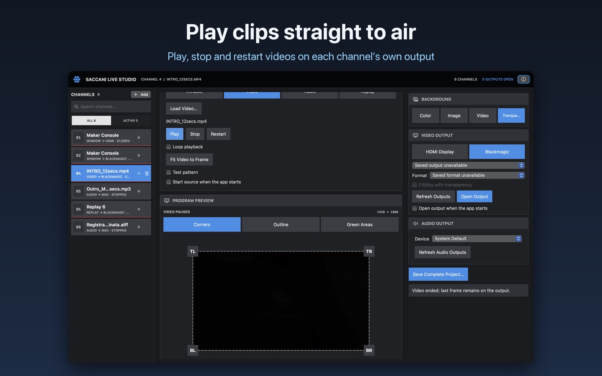

# Saccani Live Studio for Bitfocus Companion

Free MIT-licensed Companion connection module for **Saccani Live Studio** on macOS. Version **1.0.1**. It controls only the app; use Companion’s official Blackmagic ATEM module for the switcher, cameras and audio.

Saccani Live Studio is a free macOS app: [get it on the Mac App Store](https://apps.apple.com/us/app/saccani-live-studio/id6819031634?mt=12).

[](https://apps.apple.com/us/app/saccani-live-studio/id6819031634?mt=12)

## Install

1. Use **Companion 4.3 or later** on macOS, Windows, Linux or Raspberry Pi. Saccani Live Studio runs on its Mac.
2. In Companion, open **Modules → Import module package** and choose the `.tgz` from `pkg/`.
3. Add the **Saccani → Live Studio** connection, enter the app API URL shown in **Settings… → Remote Control**. Leave the token blank by default; supply the app token only if **Require access token** is enabled. The default URL is `http://127.0.0.1:8765`; enable LAN access in the app and use its Mac IPv4 address for a remote controller.
4. Open Saccani Live Studio, load a video or audio source, and keep the app running. App **0.21.0+** provides the network API; Replay channels need **0.22.1+** and Status **0.22.42+**.
5. Drag buttons or dials from **Presets** onto your Companion page. Each preset targets the stable channel number; deleting a channel does not renumber the others.

The module lives in the Bitfocus organisation and version 1.0.1 is awaiting Bitfocus review. Until it appears in Companion's module list, import the package from `pkg/`.

## Controls

- Play / Resume, Pause, Stop and return to beginning, Restart and play, Play / Stop toggle.
- Video Play / Pause toggle and jog forward/backward in frames or seconds. Jog preserves playback or pause and follows the identity of the selected clip.
- Audio channel volume, either an absolute 0–100% value or a relative change. The audio volume dial moves by 5 percentage points per step. Video sources play their audio on the Mac by default.
- Replay the end of the ATEM's latest clip, or of an MP4, through a channel whose source is **Replay**, for the seconds set in that channel (15 by default; a shorter clip plays whole): the last selected Replay channel in the app, or a chosen one. Audio, framing, overlay and Video Output come from that channel.
- Live chat: put the latest message or the latest Super Chat/membership on air, hide it, or browse the latest 50 messages with a dial and press to put the previewed one on air.
- Stop a replay started by this connection and restore its original source. Replays started from another connection, Elgato or the app must be stopped by their owner or by **Stop Replay** in the app.
- Dynamic variables for filename, source type, playback/loading state, output state, clip-relative position, remaining time, progress and audio volume. `last_error` reports command failures. Counters are clip-relative; they are not original camera timecode or SMPTE drop-frame counters.
- Channel enable: toggle a channel on or off, or always enable or disable it.
- Status: buttons that show a row of the app's Status checklist in its colors, blinking on alert, or all alerts as a master warning; a press clears the alerts.
- Feedback colors for playback, loading/replay, readiness, output, chat on air, Status rows and app offline.

Leave the action's MP4 file and the connection's **Default replay MP4 file** blank to replay the ATEM's latest clip, as the Stream Deck plugin does: with app **0.22.30+**, the app finds the newest finished PROGRAM recording in the disk folder set in its **Settings… → ATEM**, mounting the ATEM's network share if needed. Or set an absolute MP4 path, which belongs to the Mac running the app; clips are never uploaded. Stopping recording, copying recordings and discarding takes remain in the Stream Deck plugin.

Preset dials expose rotation and press actions. Actual availability depends on your surface and Companion's surface driver. The Elgato plugin's touchstrip artwork and hold-to-accelerate behavior are not reproduced.

## Replay

With app **0.22.1+**, choose **Replay** as a channel's source in the app and configure its Video Output, audio, framing and overlay there. In **Replay the latest ATEM clip or an MP4**, keep **Last selected Replay channel in the app** or choose a Replay channel. The app opens the configured output if needed, takes it from the channel that was using it and gives it back at Stop, completion or a failed start.

## Live chat

In the app, choose **Chat** as a channel's source, connect it to a YouTube broadcast and keep the channel in **Highlight** mode.

- **Chat: put a message on air / hide** shows the latest message, or the latest Super Chat or membership; when something is on air, the same press hides it.
- **Chat: hide message on air** always hides.
- **Chat: browse messages (dial)** moves a preview through the latest 50 messages (negative = older). At the newest message the preview follows new messages; after browsing back it stays put. **Chat: put previewed message on air / hide** puts the preview on air, or hides it when it is already there.

Each Chat channel has presets for these keys and a dial whose text shows the preview position, author and message. Variables `chat_<tab>_…` expose status, mode, the message on air and the preview; feedbacks mark a message on air and messages available in Highlight mode. Deleted messages leave the preview and the screen at once. The look, position and **Hide after** time are set in the app. In Feed mode the app shows messages automatically, so only hiding is possible.

## Channel enable

With app **0.22.51+**, **Channel: enable / disable** toggles a channel, or always enables or disables it. A disabled channel shows nothing on its output or as an overlay on another channel, and a Status channel plays no sound; its source keeps running. The app can also disable a channel by itself when the ATEM starts streaming or recording. The **Channel enabled** feedback, the `tab_<n>_enabled` variable and a **Channel enable / disable** preset per channel show and change the state.

## Channel source

With app **0.22.78+**, **Channel: choose what a Channel source shows** sets which channel a channel with a Channel source shows, and the **Channel source shows this channel** feedback lights the button while it does. A channel cannot show an audio channel, itself or a channel that leads back to it.

## Status

With app **0.22.42+**, choose **Status** as a channel's source: a live checklist of the ATEM, microphones, cameras, recording and streaming, with alerts.

- **Status: show a row with its colors** (advanced feedback) gives a button the label, value and colors of a row; an uncleared alert blinks twice a second between its alert colors and the normal ones. Row **0** is a master warning: ALL OK, or the first alert with the number of alerts.
- **Status: clear alerts** silences the app's chime and stops the blinking; the rows keep their alert colors until the problem is solved.
- **Status: alert not yet cleared** is a boolean feedback for one row, or for the whole channel with row 0.

Each Status channel has presets for the master warning and every row, all clearing the alerts on press. Variables `status_<tab>_row_<n>` and `status_<tab>_alerts` show each row's text and the number of uncleared alerts.

## App Store edition

In the Mac App Store edition, use **Settings… → General → Allow Replay Recordings Folder…** to grant access to external replay recordings.

## Connection and lifecycle

The connection uses HTTP commands with UUIDs and live WebSocket snapshots, falling back to HTTP reads when the event stream is unavailable. It waits for operation results, serializes transport/jog/volume, rejects stale state and changed clips, and does not retry timed-out playback commands. Closing/reconfiguring the connection cancels its own pending replay. It does not launch the app, start video outputs, select audio devices or save settings automatically.

The module does not read controller-local media or control files, has no native dependencies and talks only to the app’s HTTP/WebSocket API.

Remote Companion is supported. Use a trusted LAN or a TLS proxy; the app itself serves HTTP. Replay paths are resolved on the app Mac, without uploading clips. Playback, output and hardware reliability still need testing in the intended production setup.

The [public API specification](https://github.com/Supergiovane/SaccaniLiveStudio/blob/main/docs/control-api-v1.md) describes commands, events, errors and authentication.

## Development

Requires Node **22.20+ within Node 22** and Yarn 4 (via Corepack). Run:

```sh
nvm use
corepack yarn install
corepack yarn check
corepack yarn test
corepack yarn package
```

The official Bitfocus packaging tool validates the manifest and bundled licenses and generates the `.tgz` in `pkg/`, with the assembled license notices inside the package. No Elgato SDK, ATEM library or native Blackmagic helper is bundled. The app is a separate product with its own license.

Automated checks cover command acknowledgement, unavailable/stale/busy state, clip replacement during queued jogs, relative-volume sequencing, replay ownership/cancellation, Replay channel validation, chat commands and browsing, Status rows, blinking and clearing, and SDK action/feedback/preset registration. The native app's regressions additionally exercise actual video/audio players and replay restoration. Automated checks are not a full show/hardware acceptance test.
